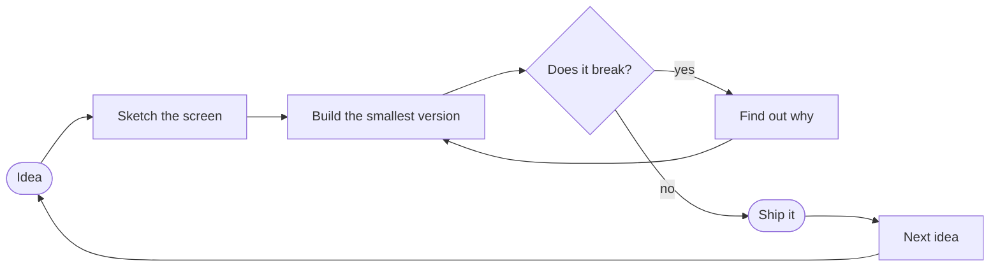
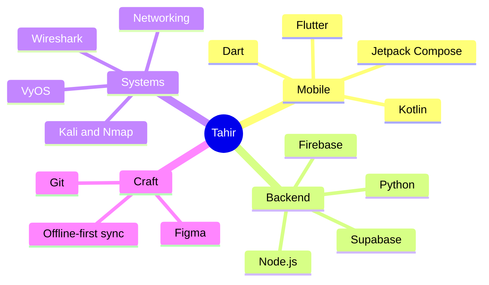

<div align="center">

```
████████╗ █████╗ ██╗  ██╗██╗██████╗
╚══██╔══╝██╔══██╗██║  ██║██║██╔══██╗
   ██║   ███████║███████║██║██████╔╝
   ██║   ██╔══██║██╔══██║██║██╔══██╗
   ██║   ██║  ██║██║  ██║██║██║  ██║
   ╚═╝   ╚═╝  ╚═╝╚═╝  ╚═╝╚═╝╚═╝  ╚═╝
        h a s s a n   ·   l a h o r e
```

**I build things to understand them.**

[Portfolio](https://tahirhassan.me) · [LinkedIn](https://linkedin.com/in/tahirdotdev) · [Instagram](https://instagram.com/tahirhassan_hafiz) · [Email](mailto:chatwithme2344@gmail.com)

</div>

---

### `$ whoami`

```console
tahir@lahore:~$ whoami
Hafiz Muhammad Tahir Hassan

tahir@lahore:~$ cat /etc/role
student   BS Information Technology, University of Education (4th sem)
day job   L2 Merchant Support Agent, Abacus BPO
night job everything below

tahir@lahore:~$ uptime
up since 2004, load average: 3 side projects, 1 degree, 1 job

tahir@lahore:~$ echo $DAILY_DRIVERS
Flutter  Python  Kotlin

tahir@lahore:~$ echo $DIGGING_INTO
networking  security  how systems work underneath
```

---

### The short version, as code

```dart
class Tahir extends Developer {
  final city = 'Lahore, Pakistan';
  final languages = ['Dart', 'Python', 'Kotlin', 'TypeScript', 'C++'];
  final tools = ['Flutter', 'Jetpack Compose', 'Supabase', 'Firebase', 'Wireshark', 'Nmap'];

  Future<void> build(Idea idea) async {
    while (!idea.worksYet) {
      sketch(idea);
      ship(idea.smallestVersion);
      breakIt();          // on purpose
      learnWhyItBroke();  // the actual point
    }
  }

  @override
  String toString() => 'I like the space between apps, networks, and the layers underneath.';
}
```

---

### How I work



---

### The stack, mapped



---

### Things I'm building

| Project | Built with | In one line |
| :-- | :-- | :-- |
| **Digital Scrapbook** | Flutter · Supabase | Memories that still work with no signal (offline-first sync) |
| **Bijli Gyi** | Kotlin · Jetpack Compose | A survival game about Pakistani load-shedding |
| **Lost and Found** | Kotlin · Compose · Oracle | Campus lost property, minus the notice board |
| **CGPAPro** | Kotlin · Compose | A GPA calculator that does the maths and nothing else |
| **Time Loop Heist** | HTML · Canvas · Web Audio | Plan a heist, then team up with your own ghost |

<details>
<summary><b>🧪 The home lab</b></summary>

<br>

```text
WSL2 ── Kali Linux ── Nmap       scanning what I own
   │
   ├── Wireshark                 reading packets for fun
   └── VyOS                      building the router instead of buying one
```

Ethical hacking, learned hands-on and only on my own machines.

</details>

<details>
<summary><b>📜 Rules I code by</b></summary>

<br>

1. Ship the smallest version that works, then improve it.
2. If I can't explain it, I don't understand it yet.
3. Offline first. Not everyone has good internet.
4. Read the error message. All of it.
5. Build the thing to learn the thing.

</details>

<details>
<summary><b>🥚 You found the easter egg</b></summary>

<br>

If you read this far, we should probably talk.
[Say hi](mailto:chatwithme2344@gmail.com).

</details>

---

<div align="center">

<sub>`last compiled in Lahore` · `built with caffeine, curiosity and a lot of hot reloads`</sub>

</div>
